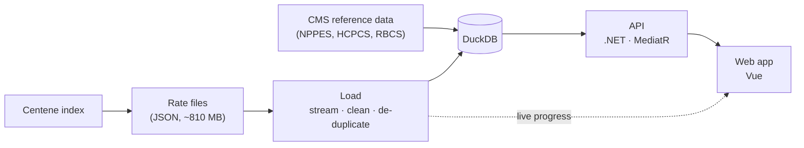

# Price Transparency Explorer

Search what a health plan pays for a service, and see how each provider's price compares with everyone else's.

Built on Centene's Fidelis Care price files (New York): Ambetter and the Essential Plan, three months (Jul 27, Aug 31 and Sep 28, 2026).

```bash
docker compose up --build
```

App: http://localhost:8080 · API reference: http://localhost:8080/scalar

The first start downloads about 810 MB from Centene. The page opens right away and shows loading progress.

## Design



- **Load:** the API reads the payer's index, downloads each rate file it lists, and reads the file one service at a time. It cleans the rows, drops duplicates and saves each file in one transaction.
- **API:** each request is a MediatR query with a validator and its own SQL file.
- **Web:** the page state lives in the URL, so every view is a shareable link. Server data is cached by Vue Query.

The full design, with diagrams of the data model and one search step by step, is in [docs/architecture.md](docs/architecture.md).

## The app

| Page | What it answers |
|---|---|
| **Search** | What does the plan pay for this service, and where is it cheapest? Add an NPI or tax ID to see where one provider sits. |
| **Price gaps** | Which services have the widest price differences? |
| **Providers** | How does one practice compare across everything it's paid for? |
| **Compare plans** | Does the same provider get the same price from both plans? |
| **Changes** | What went up, down, appeared or disappeared since last month? |
| **Where the data comes from** | Which files were loaded, when, and what was cleaned up. |

Every page leads with one answer in plain words, like "Surgery center $511" or "Same price in both plans: 81%". Codes, IDs and the method sit behind "Details".

## How it works

- **Fair comparisons.** Prices are compared only like for like: same plan, code, doctor or facility fee, setting and modifiers. Each provider counts once.
- **Plain numbers.** "Typical" needs at least 5 providers and "Most" at least 10. With fewer than 5, the page just lists each price. No page says median or percentile; the API keeps the exact figures.
- **Traceable.** Every price links back to its file, the file's dates, its checksum and its exact spot in the JSON.
- **The API.** `GET /api/v1/rates?code=45378&npi=…&ein=…` returns the price groups, each provider's price and hints for empty results. The other endpoints, with examples, are in [docs/architecture.md](docs/architecture.md#using-the-api).

## Tech

- **API:** .NET 10, ASP.NET Core, MediatR 12.5 (the last free version), FluentValidation, Dapper, DuckDB (embedded), Serilog, OpenAPI.
- **Web:** Vue 3, Vite, TypeScript, Vuetify, TanStack Vue Query, zod.
- **Tests:** xUnit (689), Vitest (340), Playwright on the real data (62). CI builds and runs the xUnit and Vitest tests, and builds the Docker images, on every PR.

## Assumptions and tradeoffs

- **A price here is what the plan pays, not what a patient pays.** Deductibles and coinsurance decide that.
- **A provider is a tax ID.** Its clinicians (NPIs) are listed under it, and an NPI search shows that NPI's own price.
- **C# instead of Go.** These are the patterns I ship every day. Each query and handler maps one-to-one to a Go handler.
- **A database file instead of plain memory.** The brief allowed keeping the parsed data in memory. It goes into a DuckDB file instead: it runs inside the API (no server), does the math fast, and the data survives restarts.
- **Three months, not one.** Price changes need more than one file. The brief's month is the middle one.
- **Simple pages over complete ones.** The people reading prices aren't statisticians, so each page shows one answer and hides the rest.
- **Scope.** One payer, outpatient and doctor rates only (what these files hold), no login.
- **The brief said 3 hours.** The core search came first and is tagged `v1-core`. Everything after it is an extra.

## Data problems found

Figures are from the Aug 31 files unless noted.

| Problem | Example | What the app does |
|---|---|---|
| The procedure code is hidden in a notes field | Knee arthroscopy (29881) exists only under revenue code 0490 | Searches by the hidden code |
| Most rows are copies | Ambetter, Aug 31: 179,948 prices, 7,727 unique (96% copies) | Drops copies while loading |
| Leading zeros are missing | `490` is 0490; anesthesia `812` is 00812 | Restores them; both forms search |
| One file names the wrong providers | Sep 28 Essential Plan file: names match the other files for 9% of practices, against about 98% elsewhere | Takes names from the reliable files; 61 show "Unknown practice" |
| Networks put their name on their members | "Chinese American IPA" is on 253 practices' tax IDs (Ambetter, Sep 28) | Shows each practice's own name |
| Group IDs change every month | `provider_group_id` is renumbered in each file | Matches providers by tax ID |
| Suspect IDs | 2 NPIs fail their check digit; 326 tax IDs in Ambetter's file use prefixes the IRS never issues (likely Social Security numbers) | Flags the NPIs; masks those tax IDs |
| Relabeled rates look like churn | Aug → Sep: 5,855 "new" and 5,853 "gone" rates are the same provider and service | Leaves them out of the change counts by default |
| Health centers are paid per visit | FQHC and RHC rates bundle the whole visit | Never compared with office fees |
| Out-of-network amounts may cover several claims | A 15-minute therapy code has a middle amount of $1,814.70 | Shows only ranges, never a typical figure |
| Each file has three dates | Index Aug 31, file Sep 2, server Sep 4 | Keeps and shows all three |

Sanity check: a colonoscopy at a surgery center on the Essential Plan is $510.83 (Sep 28), within $1 of Medicare's 2026 surgery-center rate ($510.49).

More detail on each rule and finding: [docs/details.md](docs/details.md).

## Next

- Show each price as a percent of Medicare, the benchmark everyone uses.
- Estimate a whole procedure: facility + doctor + anesthesia.
- Add more payers, and CMS's schema 3.0 files when they arrive.
- Load new months without a restart.

## Develop

| Part | Needs | Command |
|---|---|---|
| API | .NET 10 SDK | `dotnet run --project src/PriceExplorer.Api` (http://localhost:5080) |
| Web | Node 24 | `cd web && npm ci && npm run dev` (http://localhost:5173) |
| Tests | | `dotnet test` · `cd web && npm run test:unit` · `npm run test:e2e` (with the app running) |

## Built with AI

Built with Claude Code. I made the scope, data and design decisions, and the AI wrote most of the code and tests. Every PR passed CI, and each feature had an independent review on the real files before merging.

## Notice

Prices come from the payer's public Transparency in Coverage files. CMS data (NPPES, HCPCS Level II names, RBCS categories) and the Census ZIP-to-county file are public domain.

Service names are our own words, or CMS's category with the code. The app never shows or keeps CPT or CDT descriptions.

CPT® is a registered trademark of the American Medical Association. CDT is a trademark of the American Dental Association.
