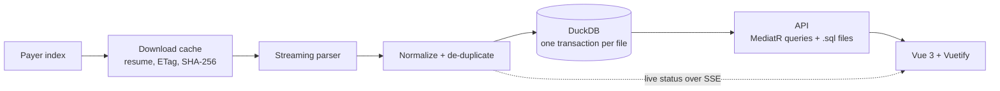

# Price Transparency Explorer

Search what a health plan has agreed to pay for a service, and see how each provider's rate compares with every other provider's rate for the same service in the same setting.

It reads three monthly **Transparency in Coverage** indexes from Centene's Fidelis Care (2026-07-27, the brief's 2026-08-31, and 2026-09-28), loads every in-network rate file they list (Ambetter from Fidelis Care and the Essential Plan, about 810 MB of JSON in all) and their out-of-network allowed-amount files, cleans and de-duplicates them into DuckDB, and serves a search API and a Vue web app. Pages show the newest month; the app bar switches to any other.

**Search** needs a billing code (CPT, HCPCS or revenue code). NPI and EIN are optional and narrow the results to one provider, which is then shown against the market.

## Who it's for

One neutral explorer, with a "start here" card and a short "what this means for you" panel for each audience:

| Audience | Question it answers |
|---|---|
| Providers | Where does my rate sit against other providers for the same service and setting, and how has it moved? |
| Health plans | Where are prices spread widest, which rates are outliers, and what changed since the last file? |
| Employers | What does a service typically cost, how far above the lower quartile is a typical rate, and how is the median moving? |
| Innovators | How clean is this data, and can I trace and build on every number? |
| Life sciences | What does a drug or device cost per unit, by site of care? |

## Run it

Requires Docker.

```bash
docker compose up --build
```

- App: http://localhost:8080
- API docs (OpenAPI + Scalar): http://localhost:8080/scalar

The first start downloads the rate files (about 810 MB for the three months) and loads them in the background, newest month first. Parsing all six files takes about 5 s and saving the three months' statistics about 8 s; the rest is download time. The app opens immediately and shows live loading progress, and searches answer as soon as the first file is saved. Files load one at a time, so memory stays modest: loading all three months peaked at about 560 MB (working set), against about 470 MB for the brief's month alone. Restarts reuse the downloaded files: the payer is re-checked with ETags, and unchanged files aren't parsed again. To start fresh, run `docker compose down -v`.

## Develop

| Part | Needs | Command | URL |
|---|---|---|---|
| API | .NET 10 SDK | `dotnet run --project src/PriceExplorer.Api` | http://localhost:5080 |
| Web | Node 24 | `cd web && npm ci && npm run dev` | http://localhost:5173 (proxies `/api` to :5080) |
| Tests | | `dotnet test` · `cd web && npm run test:unit` · `npm run test:e2e` | |

API tests need no network. They run real ingestion against a fake payer server, using small slices cut from the real Centene files (`tests/PriceExplorer.Tests/Fixtures`) and a few small synthetic files. The end-to-end tests run against a live API (`E2E_BASE_URL`).

## Stack

- **API:** ASP.NET Core (.NET 10), controllers + MediatR queries, FluentValidation, RFC 9457 problem responses, OpenAPI + Scalar, Serilog, DuckDB (embedded) with Dapper.
- **Web:** Vue 3 + Vite + TypeScript, Vuetify 4, TanStack Vue Query, zod.
- **Tests:** xUnit v3 + AwesomeAssertions, Vitest, Playwright.

## How it works



- **Ingestion** runs in the background. A file is streamed element by element, so memory stays flat whatever the file size. Each file is saved in one transaction, so a search never sees half a file. One failing file never stops the others; a payer outage falls back to the cached copy.
- **API**: ASP.NET Core controllers send MediatR queries. Each query has a validator, and each handler runs its own `.sql` file next to it. Errors are RFC 9457 problem responses with camelCase field errors. While nothing is loaded, data endpoints answer `503` with `Retry-After`.
- **Every rate is traceable.** The source drawer shows the file URL, the index date, the file's own date, HTTP Last-Modified, SHA-256, the JSON path of the price, and the values as published. The **sources page** (`/sources`) lists every file with its dates, checksums, published → unique counts, each clean-up rule's count, and everything set aside with its reason and first example.

## What the data looks like (measured on the 2026-08-31 files)

| Finding | Numbers | What the app does |
|---|---|---|
| Facility rates hide the procedure code | Hospital and surgery-center rates are filed under revenue codes, with the CPT in `additional_information`. Knee arthroscopy (CPT 29881) exists **only** as revenue code 0490 rows. | The CPT becomes the searchable code. The result says "facility rate under revenue code 0490". |
| Most rows are duplicates | Ambetter: 179,948 published prices → 7,727 unique. Essential Plan: 359,853 → 9,822. About 96% are repeats. | Collapsed at load, with a count of copies kept for each rate. |
| Revenue-code item names are unreliable | The 29881 rows appear under 151 different item names. | Kept only as source labels, never used as the procedure's name. |
| Leading zeros are stripped | Revenue code `490` = 0490. Anesthesia CPT `812` = 00812, priced per anesthesia unit ($7.94). | Codes are restored to standard form; the published value is kept. Search accepts either. |
| Professional fees are mostly fee schedules | For one code, 49 of 51 providers have exactly $167.09. Facility fees for the same procedure vary about 5×. | Groups where most providers share one rate are labeled as a fee schedule, not a negotiation. |
| Some provider IDs are invalid or sensitive | 2 NPIs fail the check digit. 326 (Ambetter) and 102 (Essential Plan) tax IDs use EIN prefixes the IRS never issues (likely Social Security numbers). 5 groups list `npi: [0]`, meaning a contract with the whole tax ID. | Invalid NPIs are flagged. Never-issued EINs are masked (`••-•••1234`) and identified by a key that can't be turned back into the number (an HMAC under a secret made once per install). Whole-tax-ID contracts are labeled. |
| One NPI, many listings | 8,094 of 43,833 Ambetter NPIs appear in more than one provider group. | Results count one value per provider (tax ID) per comparison group. |
| One tax ID, different rates per clinician | Teladoc's 99213 telehealth rate is $45 for most of its 319 NPIs and $90 for others. | The row shows the rate most of its NPIs are paid, with the range; the NPI list shows each NPI's own rate. An NPI search shows that NPI's rate. |
| Telehealth depends on where the patient is | 141 provider-code pairs pay telehealth at home (POS 10) differently from elsewhere (POS 02). | Two separate settings. |
| Group IDs are local to each file | `provider_group_id` is renumbered in every file and every month. | Never used as a key across files. |
| Three dates per file | The index date in the file name (2026-08-31), `last_updated_on` inside each file (2026-09-02), and HTTP Last-Modified (2026-09-04). | All three are kept and shown in the source drawer. |
| Rates that aren't comparable | Clinic (FQHC/RHC) rates are all-inclusive per-visit payments. | Kept in their own setting, never compared with office fees. |
| What's absent | Every price has `expiration_date` 9999-12-31 (no end date). No inpatient DRGs; codes are CPT, HCPCS or revenue codes only. | Expiry shown as "no end date". The scope is outpatient and professional rates. |
| Out-of-network amounts are thin, repeated, and don't say what they cover | Plans list a provider and service only with 20+ claims in a 90-day window: 33 codes (Ambetter) and 115 (Essential Plan). Revenue-code items repeat the same payments under unrelated names: 237 published → 103 unique, 1,033 → 605. Many amounts are far above one service: CPT 97530 (a 15-minute therapy unit, about $32 in network) has a middle listed amount of $1,814.70, and a BLS ambulance code reaches $1,038,971. The files don't say whether an amount covers one visit or several. | Duplicates collapse. A small panel on search results leads with how much providers billed against what the plan allowed (Essential Plan ER facility: about 4.8 times; ambulance: about the same), which holds whatever an amount covers. The amounts themselves show only as a range, never a typical figure, and every figure needs 5 providers: with fewer, each amount is listed and nothing is compared. |
| EINs written as numbers | 6 EINs in the Essential Plan allowed-amount file have 8 digits (60646659 for 06-0646659). | The leading zero is restored before the IRS prefix check. |

## Comparing fairly

Rates are compared only like for like. A **comparison group** is:

product × code × fee type (facility or professional) × care setting × modifiers × rate type

Each provider (tax ID) counts once per group. If it has several rates in one group, the one that counts is the NPI-weighted median: the rate in the middle of its clinicians. That is always a rate someone is really paid, never an average of two. The row shows the range. The statistics shown depend on group size:

| Providers in group | Shown |
|---|---|
| under 5 | the rates themselves |
| 5–9 | median and range |
| 10 or more | percentiles (10th–90th), spread, and the **gap to the lower quartile** = median − 25th percentile |

The gap to the lower quartile is how far a typical rate sits above the cheapest quarter of providers. Plans and employers read it as room to steer care; providers read it as negotiating context. The files have no claim counts, so it is never multiplied into a total unless you enter a number of cases yourself.

Filtering by NPI, EIN, name, specialty or location narrows the rows to the matching providers' rates (an NPI search shows that NPI's own rate), but the statistics stay market-wide. So a provider is shown as "17th percentile, 0.92× median" against everyone else. Providers paid the same rate count half in a percentile, so a provider paid the fee-schedule rate most of its group gets sits near the middle, not at the bottom. Care settings come from CMS place-of-service codes. Hospital outpatient (POS 19 and 22) is one setting. Clinics, and telehealth at home versus elsewhere, each have their own.

## Extra: who is behind each rate

The rate files list bare NPIs. `reference/provider_directory.csv.gz` (1.9 MB) gives the 58,688 NPIs in the files a name, specialty and practice place, from the October 2026 NPPES release, the NUCC taxonomy and Census ZIP-to-county data. `tools/PriceExplorer.ReferenceBuilder` rebuilds it (see `reference/README.md`).

- Each provider row shows who its NPIs are: "Gastroenterology Physician · Manhattan, NY · +12 more".
- Filter by **specialty** or by **New York county or NYC borough**. With both, one NPI must have that specialty and practice there. Like an NPI filter, they pick rows; the statistics stay market-wide. A specialty picked from the list finds just that specialty. Typed words match the start of words in specialty names, so "urology" never finds neurologists, and common forms work ("cardiologist", "ENT", "OB/GYN", "orthopaedic"). Locations take county or borough names ("Kings County", "The Bronx") or "NYC".
- **Check this** flags mark listed rates that look unusual for the provider: a facility rate whose NPIs are all individual clinicians, anesthesia without an anesthesia clinician, a CT, MRI or PET read with no radiologist or nuclear medicine physician (cardiologists count for cardiac scans), deactivated NPIs. The files list contracted rates, not services performed, so a flag is a prompt to verify.

## Price history

Three monthly files are loaded. The snapshot picker in the app bar switches every page to another month, and the choice stays in the URL.

- **Changes** (`/changes`): the same provider (tax ID) in the same comparison group, between two files. The page says a rate went up or down (in dollars and percent), is new (only in the newer file) or is gone (only in the older one); the API calls these changed, new and dropped. Providers are matched on their tax ID key, never on `provider_group_id`, which the payer renumbers every month. A change means the file lists a different rate. It isn't a claim, and the files don't say how often a service is used.
- **Listed differently**: a quarter (July to August) to two fifths (August to September) of new and dropped rates are the same provider and code under other modifiers or another setting. Centene reshuffles telehealth modifiers (`95,GQ,GT` becomes `95,GT`). These are marked, and a switch hides them.
- **Trends**: each group card draws its typical price (the median) across the files, the range most providers get (10th to 90th percentile, from 10 providers) and, with an NPI or EIN, that provider's own rate, with the same numbers in words ("The typical price went from $573 (Jul 27) to $569 (Sep 28): down $4 (under 1%).", worked out from the figures as the card shows them). The trend runs the search itself in each month, so every point equals that month's card.
- **Partial uploads**: Centene has published partial months before (Ambetter files of 9 MB and 4 MB, against about 90 MB). Each product's file is compared with the same product in up to two months on each side: unique rates, EINs and codes, each against the nearby median. Below 0.8 on any of them, the file is flagged partial and left out of changes. The three loaded months all score 0.94 or more.

| Between | Changed (up, down) | New (listed differently) | Dropped (listed differently) | Unchanged |
|---|---|---|---|---|
| 2026-07-27 and 2026-08-31 | 4,619 (2,556, 2,063) | 8,843 (2,268) | 8,232 (2,099) | 48,409 |
| 2026-08-31 and 2026-09-28 | 3,932 (1,975, 1,957) | 14,632 (5,858) | 16,776 (5,856) | 41,163 |

Counts are of provider values: one per provider per comparison group. When a provider has several rates in a group, its value is their NPI-weighted median, so it can also move when a rate is added or removed; the changes page marks those rows.

## API

| Endpoint | |
|---|---|
| `GET /api/v1/rates?code=&npi=&ein=&provider=&specialty=&county=&product=&setting=&feeType=&group=&sort=&page=&pageSize=&snapshot=` | Comparison groups, provider rows, and hints that explain empty or surprising results. Every hint link is checked to find rates before it's sent. |
| `GET /api/v1/rates/{id}/source` · `/npis?provider=&alsoRate=` | Where a rate came from; the NPIs behind a result row, each with its rate |
| `GET /api/v1/codes?q=` · `/providers?q=` · `/specialties?q=` · `/reference` | Typeahead and filter options (including New York counties and the registry release) |
| `GET /api/v1/status` · `/status/stream` | Loading progress (the stream uses server-sent events) |
| `GET /api/v1/snapshots` · `/snapshots/{id}/plans` | Loaded files, their sources and counts, and how complete each looks; plans per product |
| `GET /api/v1/sources` | Every snapshot and file (rate and allowed-amount files): URL, three dates, size, SHA-256, ETag, counts, rejects by reason, timing |
| `GET /api/v1/out-of-network?code=&codeType=&snapshot=` | What the plan allowed out of network for a code, per product and fee type |
| `GET /api/v1/changes?from=&to=&product=&code=&kind=&minChangePct=&listedElsewhere=&sort=&page=&pageSize=` | Rates that changed, appeared or dropped between two snapshots, with counts by kind. Defaults: the newest snapshot against the one before. |
| `GET /api/v1/rates/trend?code=&npi=&ein=&provider=&product=&setting=&feeType=&snapshot=` | Each comparison group a search shows, in every snapshot: provider count, median and quartiles, and the searched provider's rate |
| `/health/live` · `/health/ready` | Ready once rate data can be searched |

## Assumptions and tradeoffs

- **C# and .NET instead of Go.** I used the patterns I ship every day: MediatR queries with handlers, validators and SQL files. Each one maps one-to-one to a Go handler and query.
- **DuckDB, embedded.** It's columnar and fast at percentiles, needs no server, and the volume survives restarts. Readers get a consistent view while a file is being written.
- **Load everything at startup, in the background.** A month is small (about 17,500 unique rates), so search computes its statistics per request. After loading, each month's statistics are also saved (one value per provider per group), because the changes feed compares every group at once.
- **Scope**: outpatient and professional rates (that is what these files contain), one payer, no login. MediatR is pinned to 12.5.0, the last Apache-2.0 release.
- **A negotiated rate is not a patient's cost.** Deductibles, coinsurance and out-of-network rules decide what a person pays.

## What I'd add next

- **% of Medicare** for each rate, the benchmark plans, employers and providers all use. The comparison groups and units are already in place.
- **CMS schema 3.0.** Network-level files arrive quarterly from April 2027 under the October 2026 final rule.
- More payers and indexes. The parser already handles gzip, string numbers, either key order and inline provider groups.

## Built with AI

This was built with Claude Code. I made the scope, data-handling and metric decisions; the AI wrote most of the code and tests. Every PR had to pass CI. Each core PR also went through adversarial reviews on the real files: independent reviewers recomputed every number from the database and followed every hint link, and an issue counted only if a second check reproduced it. The search API took six rounds (12, 17, 23, 34, 15 and 9 confirmed issues, the last two rounds with nothing high-severity). Those reviews caught real problems: an NPI search showing the tax ID's blended rate, masked tax IDs that could be reversed from their keys, a surgery center's Botox charge shown as a per-unit price, and hints that pointed to empty pages. Each now has a test.

## Notice

CPT® is a registered trademark of the American Medical Association. Code names and descriptions appear only as published in the payer's files. Revenue-code and modifier labels are this project's own short wording.
