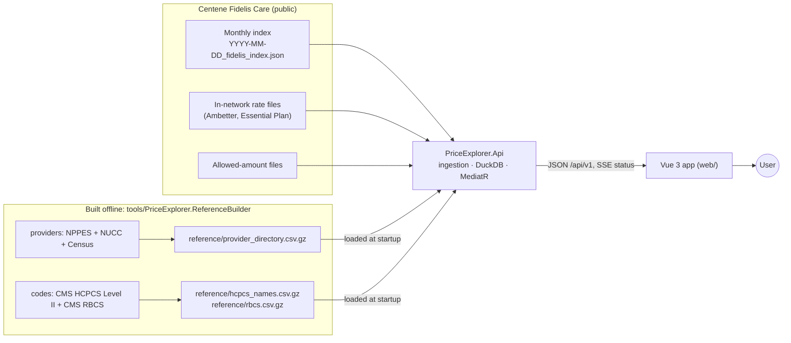
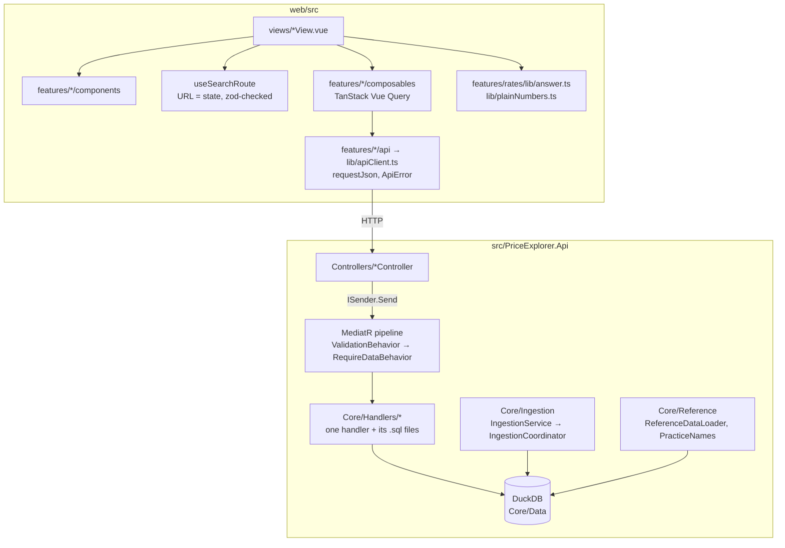
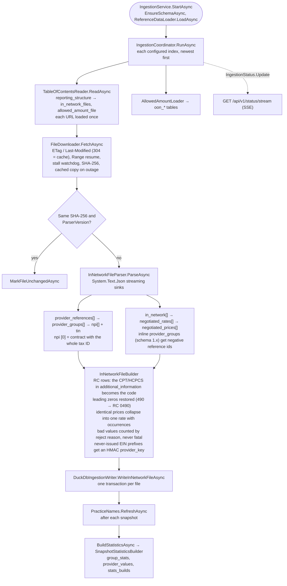
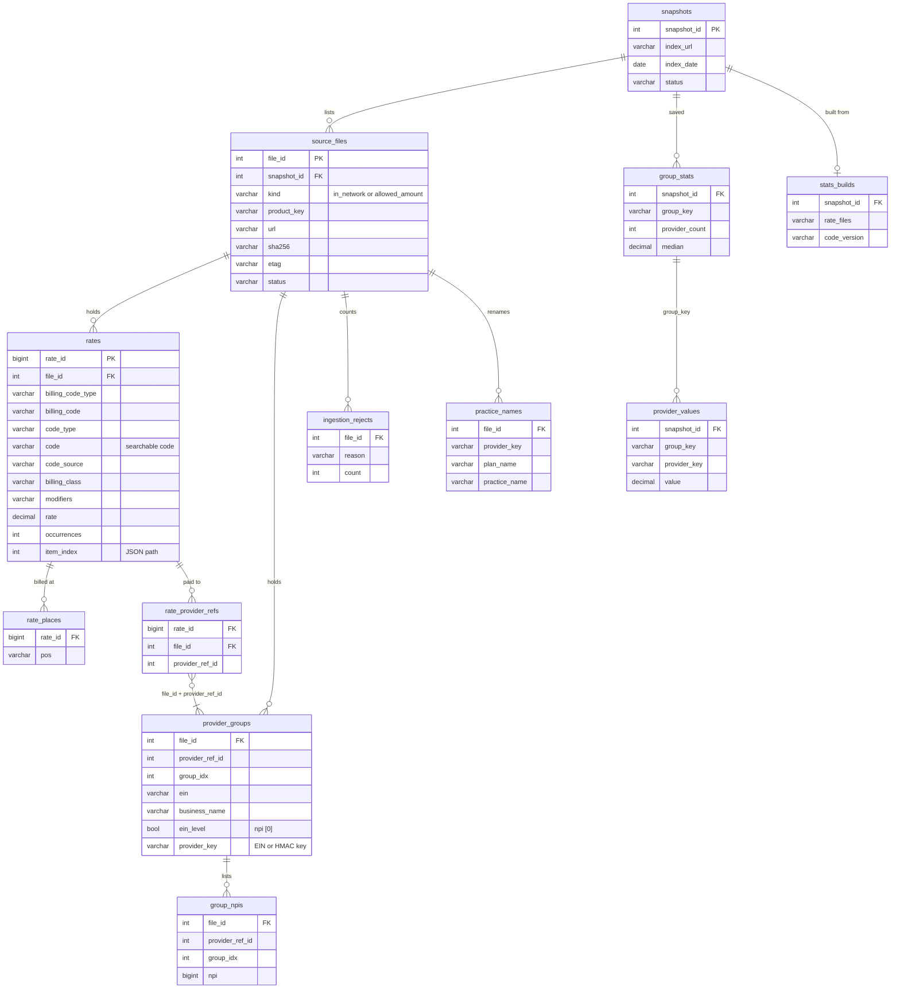
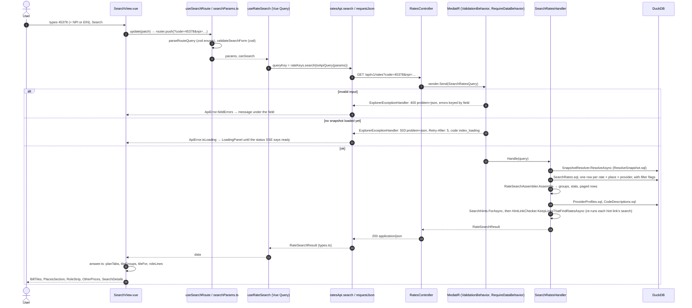
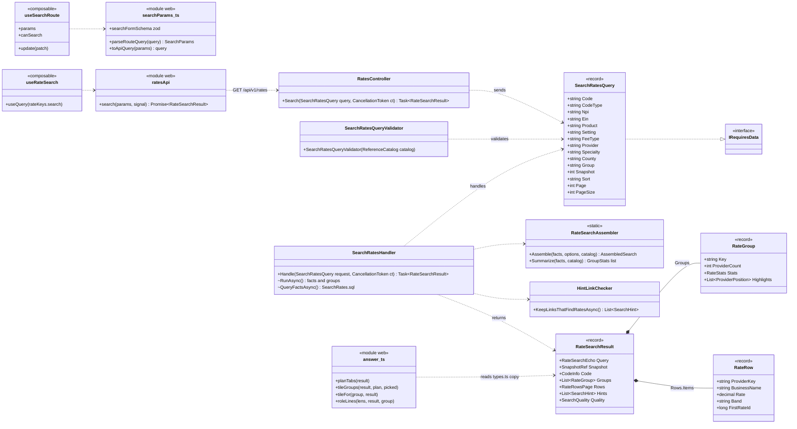

# Architecture

How the Price Transparency Explorer is built, for someone about to work in the code. The [README](../README.md) covers what it does and why. Every class, file and endpoint named here exists in the repo.

## 1. Purpose and scope

The brief: read a payer's Transparency in Coverage **index**, follow it to the **in-network rate files**, normalize them, and serve a **search API** keyed by a required billing code with an optional NPI and EIN, plus a UI on top.

This repo does that for Centene's Fidelis Care (three monthly indexes, two plans). It adds:
- out-of-network allowed amounts;
- a provider directory (NPPES), CMS code categories and HCPCS names;
- price history across months;
- insights pages (price gaps, plan comparison, provider scorecard);
- plain-language pages, with every number traceable to its file.

## 2. System context



The API downloads and loads the payer files itself, in the background, at startup. Reference files are committed to `reference/` and loaded into DuckDB at every start; rebuilding them is a manual `ReferenceBuilder` run.

## 3. Components



| Folder | What's in it |
|---|---|
| `Controllers/` | Thin ASP.NET Core controllers: bind the query string, `sender.Send(query)`, return the record. |
| `Core/Queries/` | One record per request (`SearchRatesQuery`) and its FluentValidation validator (`SearchRatesQueryValidator`). |
| `Core/Behaviors/` | `ValidationBehavior` and `RequireDataBehavior`; requests that need loaded data implement `IRequiresData`. |
| `Core/Handlers/` | One `IRequestHandler` per query. SQL lives in `.sql` files next to it, embedded and loaded with `SqlFile.For<T>()`. Dapper maps rows to records. |
| `Core/Models/` | Response records (`RateSearchResult`, `RateGroup`, `RateRow`…), serialized camelCase. |
| `Core/Ingestion/` | Index reader, downloader, streaming parser, DuckDB writer, saved statistics, live status. |
| `Core/Data/` | `Schema.sql`, `DuckDbConnectionFactory`, `SnapshotResolver`, `SavedStatistics`. |
| `Core/Reference/` | Settings, revenue codes, modifiers (`.tsv`), the provider directory, CMS codes, practice names. |
| `Hosting/` | DI and middleware: `ApiExtensions`, `IngestionExtensions`, `ExplorerExceptionHandler`, `ObservabilityExtensions`. |

**Pipeline.** `ValidationBehavior` runs first, so bad input is a 400 even while data loads. `RequireDataBehavior` then throws `IndexNotReadyException` (503) until a snapshot is searchable. `ExplorerExceptionHandler` turns both, and any `ExplorerException`, into RFC 9457 problem responses.

**Web.**
- Each page keeps its state in the URL. `parseRouteQuery` reads it, with zod enums for sort and lens. `searchFormSchema` (zod) checks the form and pasted links before any request.
- Vue Query caches by API query and snapshot (`rateKeys`), with no retries. The status SSE (`useDataStatus`) invalidates queries when data becomes ready.
- Responses are typed by TypeScript interfaces in `features/*/api/types.ts`; they aren't validated at runtime.

**Docker Compose.** Two services:
- `api`: built from `src/PriceExplorer.Api/Dockerfile`, published on `5080:8080`, with the volume `explorer-data:/data` for downloads and DuckDB.
- `web`: nginx on `8080:80`. It serves the built app and proxies `/api/`, `/openapi` and `/scalar` to `api:8080`; `/api/v1/status/stream` is proxied unbuffered.

## 4. Ingestion



- Searches answer as soon as the first file is saved.
- Saved statistics (one value per provider per group) are built once every snapshot has loaded, for the changes and insights pages. Search computes its own per request.
- A restart re-checks each file with ETags and skips unchanged ones. `stats_builds` records what each build came from, so only out-of-date snapshots are rebuilt.

## 5. Data model

The key tables in `Core/Data/Schema.sql` (all DuckDB, one database file):



Also in the same database:
- `group_stats` holds the full set of quantiles (min, p10, p25, median, p75, p90, max).
- `oon_items`, `oon_payments` and `oon_providers` hold the out-of-network amounts.
- `plans` and `structure_files` hold the index.
- `code_descriptions` and `name_checks` hold code names and per-file name checks.
- `provider_directory`, `hcpcs_names` and `rbcs` are the reference tables, rebuilt at startup.
- `meta` holds the schema version and the per-install secret behind masked provider keys.

A rate's `item_index`, `rate_index` and `price_index` rebuild its JSON path: `$.in_network[365].negotiated_rates[6].negotiated_prices[1]`.

## 6. Search design

A **comparison group** is product × code × fee type × setting × modifiers × rate type. Each provider (tax ID) counts once per group, at the NPI-weighted median of its rates ([Details: Comparing fairly](details.md#comparing-fairly)).

### 6a. One search, end to end



### 6b. The search slice



## 7. Using the API

Under Docker Compose the API is at `http://localhost:8080` (through the web container's proxy) or `http://localhost:5080` (the API container).

| Endpoint | Returns |
|---|---|
| `GET /api/v1/rates?code=` (+ `npi`, `ein`, `provider`, `specialty`, `county`, `product`, `setting`, `feeType`, `group`, `sort`, `page`, `pageSize`, `snapshot`) | Comparison groups, provider rows, hints |
| `GET /api/v1/rates/{rateId}/source` · `/rates/{rateId}/npis` | Where one rate came from; the NPIs behind a row |
| `GET /api/v1/rates/trend` · `/rates/levels` | A search's groups in every month; visit levels side by side |
| `GET /api/v1/codes` · `/providers` · `/specialties` · `/reference` · `/categories` | Typeahead and filter options |
| `GET /api/v1/insights/gaps` · `/insights/compare` · `/insights/scorecard` | Insights pages |
| `GET /api/v1/changes` · `/out-of-network` · `/sources` · `/snapshots` | History, allowed amounts, files |
| `GET /api/v1/status` · `/status/stream` · `/health/live` · `/health/ready` | Loading progress and health |

Full parameters are in the [API endpoints table](details.md#api-endpoints) and the OpenAPI document.

Examples, each run against a local API with the three months loaded (results are for the newest, 2026-09-28):

```bash
API=http://localhost:8080   # or :5080

# Code only: 11 groups, 268 provider rows
curl "$API/api/v1/rates?code=45378&pageSize=2"

# Code + NPI: only that NPI's 4 groups; each group's highlights[0] places it in the market
curl "$API/api/v1/rates?code=45378&npi=1043383789"

# Code + EIN (dash optional): the same 4 groups, by tax ID
curl "$API/api/v1/rates?code=45378&ein=11-3466729"

# Filters: one plan, surgery centers, facility fees; or a specialty in a borough
curl "$API/api/v1/rates?code=45378&product=essential-plan&setting=asc&feeType=facility"
curl "$API/api/v1/rates?code=99213&county=Manhattan&specialty=family"

# Where a row's price came from: file URL, SHA-256, JSON path, values as published
curl "$API/api/v1/rates/8589937079/source?provider=113466729"
# "jsonPath": "$.in_network[365].negotiated_rates[6].negotiated_prices[1]", "rate": 143.75, ...

# Live loading status (server-sent events)
curl -N "$API/api/v1/status/stream"
# event: status
# data: {"phase":"ready","message":"Data is ready.","dataAvailable":true,"filesDone":6,"filesTotal":6,...}
```

Rate ids are assigned at load time, so take `firstRateId` from a search rather than reusing the one above.

A real response, trimmed (the facility filter above, `pageSize=1`):

```json
{
  "query": { "code": "45378", "matchedCodes": ["45378"], "product": "essential-plan", "setting": "asc", "feeType": "facility", "sort": "rate", "page": 1, "pageSize": 1 },
  "snapshot": { "snapshotId": 1, "indexDate": "2026-09-28", "isLatest": true },
  "code": {
    "codeType": "CPT", "code": "45378",
    "category": { "key": "surgery", "unit": "per procedure", "perUnit": false },
    "classification": { "key": "PG004", "category": "Procedures", "subcategory": "Digestive/Gastrointestinal", "source": "cms_rbcs" },
    "foundVia": ["Billing code (CPT)", "Facility rates under revenue code 0490 (Ambulatory surgery)"]
  },
  "groups": [{
    "key": "essential-plan|CPT|45378|facility|asc||negotiated",
    "settingLabel": "Ambulatory surgery center",
    "billedAs": [{ "billingCodeType": "RC", "billingCode": "0490", "label": "Revenue code 0490 (Ambulatory surgery)" }],
    "providerCount": 27, "statsLevel": "full",
    "stats": { "min": 247.85, "p10": 389.37, "p25": 450.92, "median": 510.83, "p75": 594.66, "p90": 624.85, "max": 688.0 },
    "lowerQuartileGap": 59.91
  }],
  "rows": { "total": 27, "page": 1, "pageSize": 1, "items": [{
    "providerKey": "465647464", "einDisplay": "46-5647464", "businessName": "Goldstep Ambulatory Surgery Center, LLC",
    "rate": 247.85, "band": "low", "vsMedian": 0.49, "percentile": 0, "occurrences": 337, "firstRateId": 8589937319
  }]},
  "hints": [],
  "quality": { "publishedRows": 9099, "uniqueRates": 27, "duplicatesCollapsed": 9072 }
}
```

| Field | Meaning |
|---|---|
| `query` | The search as the server ran it, normalized. |
| `code.classification` | The CMS RBCS category. Page titles use our own plain name for a code, else this category. |
| `groups[].key` | product\|code type\|code\|fee type\|setting\|modifiers\|rate type. Pass it back as `group=` to page that group's rows. |
| `groups[].stats` | Over one value per provider. `statsLevel` is `list` under 5 providers, `basic` for 5–9, `full` for 10+ (p10/p90 only from 10). |
| `groups[].billedAs` | How the plan filed it. Here the facility rates sit under revenue code 0490, with the CPT in `additional_information`. |
| `rows.items[]` | One per provider per group. `band` and `vsMedian` place the rate, `occurrences` counts the published copies collapsed, and `firstRateId` feeds `/source`. |
| `hints` | Why a result is empty or surprising, each link already checked to find rates. |

**Errors** are RFC 9457 `application/problem+json`, with a stable `code` and a `traceId`:

```jsonc
// 400: GET /api/v1/rates?npi=123
{ "title": "Some search inputs need fixing", "status": 400, "code": "validation_failed",
  "errors": { "code": ["Enter a billing code, for example 45378 (colonoscopy) or 0490 (ambulatory surgery)."],
              "npi": ["An NPI is 10 digits, for example 1396747861."] } }

// 404: GET /api/v1/rates?code=45378&snapshot=999
{ "title": "Not found", "status": 404, "code": "snapshot_not_found", "detail": "Snapshot 999 doesn't exist or has no rate data saved." }

// 503 while no snapshot is loaded, with header Retry-After: 5
{ "title": "Data is still loading", "status": 503, "code": "index_loading", "detail": "Rate data is still loading. …" }
```

**Interactive reference.**
- `/scalar` redirects to `/scalar/`, the Scalar UI (also `/scalar/v1`).
- `/openapi/v1.json` is the OpenAPI 3.1 document.
- Under Docker Compose both are at `http://localhost:8080/...` (nginx proxies them) and at `http://localhost:5080/...`.

## 8. Cross-cutting

| Concern | How |
|---|---|
| Errors | `ExplorerExceptionHandler` maps `ValidationException` to 400, `ExplorerException` subclasses to their status (404, 503 with `Retry-After`), and anything else to 500 `server_error`, logged once. Binding errors (`page=abc`) get the same 400 shape. The web turns every problem into `ApiError`. |
| Logging | Serilog to the console (`ObservabilityExtensions`). One request log line per call at the status the client got; expected 503s aren't errors. Each ingested file logs published → unique counts, rejects and timings. |
| Traceability | Every price keeps its file, snapshot, three dates, SHA-256 and JSON path. `GET /rates/{rateId}/source` and the Sources page show them. |
| Provider keys | Tax IDs with prefixes the IRS never issues (possible SSNs) get `provider_key` = `u` + 12 hex characters of HMAC-SHA256, under a per-install secret in `meta`, and show masked (`••-•••4567`). `ProviderKeys` computes them once, at ingestion. |
| Performance | Each file streams element by element, so memory stays flat: about 560 MB peak for all three months. The six rate files parse in about 5 s; the rest of a first start is download time. Searches on the demo API: 45378 0.29 s, 99213 0.48 s, J3301 0.19 s (median of 5, warm). |
| Tests | 680 API tests (xUnit v3, real ingestion against a fake payer server with slices of the real files), 328 Vitest, 52 Playwright e2e against a live API. |
| CI | `.github/workflows/ci.yml`: API build + tests, web lint + types + unit + build, and `docker compose build`. The e2e tests run locally against real data. |

## 9. Key decisions and limits

| Decision | Where it's argued |
|---|---|
| C#/.NET with MediatR queries, not Go; DuckDB embedded; load everything at startup | [Tradeoffs](../README.md#tradeoffs) |
| What the files contain and how each quirk is handled (RC codes, duplicates, masked EINs, mislabelled names) | [Data problems found](../README.md#data-problems-found), [in detail](details.md#what-the-data-looks-like-measured-on-the-2026-08-31-files) |
| Like-for-like comparison groups, one value per provider | [Comparing fairly](details.md#comparing-fairly) |
| Plain numbers and one answer per page | [Plain numbers, simple pages](details.md#plain-numbers-simple-pages) |
| Changes and trends never call a listing change a price change | [Price history](details.md#price-history) |
| Scope limits: outpatient only, one payer, no login, a negotiated rate isn't a patient's cost | [Tradeoffs](../README.md#tradeoffs) |
| What's next | [What I'd add next](details.md#what-id-add-next) |
