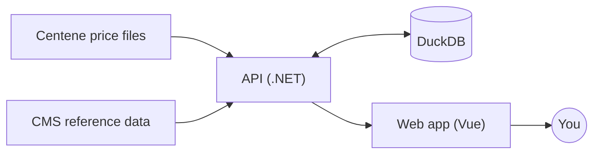
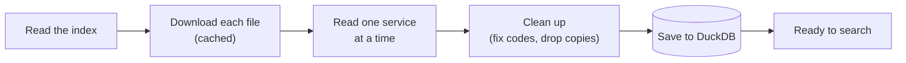
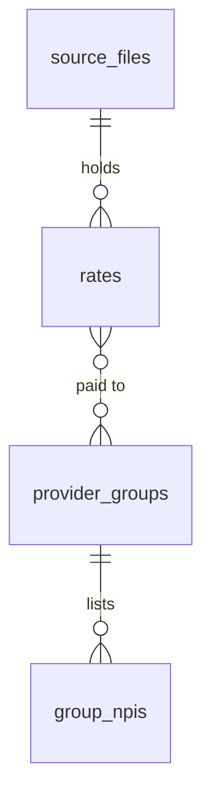
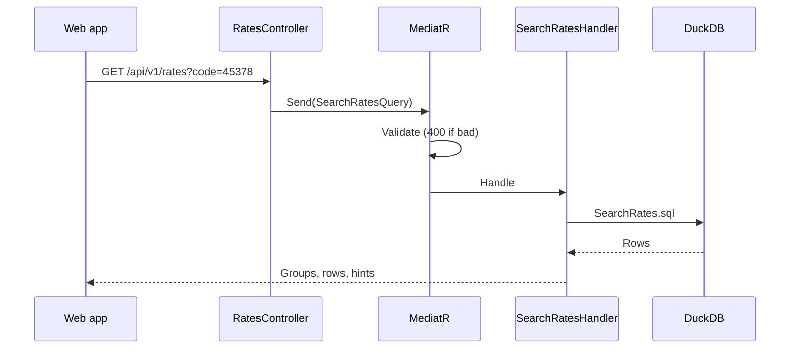
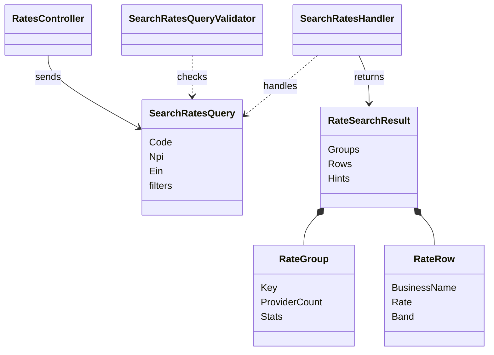

# Architecture

How the app is built. What it does is in the [README](../README.md).

## Overview



- The **API** downloads the price files, cleans them and saves them in DuckDB. Then it answers searches.
- The **web app** keeps each page's state in the URL and asks the API for data.
- Docker Compose runs both. The web container also forwards `/api` to the API.

## Loading the files



- Each file is read as a stream, so memory stays low.
- Each file is saved in one step, so a search never sees half a file.
- Search works as soon as the first file is saved. The page shows live progress.

## Data



- **rates**: one row per unique price: code, setting, fee type, amount.
- **provider_groups**: who gets a price: a practice's tax ID and name.
- **group_npis**: the clinicians (NPIs) in each group.
- **source_files**: where each price came from: URL, dates, checksum.

## Search

### One search, step by step



If no data is loaded yet, the API answers 503 and the web app retries when loading finishes.

### The classes



- A **group** is one like-for-like comparison: same plan, code, fee type, setting and modifiers.
- A **row** is one provider's price in a group.
- **Hints** explain an empty result and suggest a search that works.

## Using the API

Interactive reference: http://localhost:8080/scalar. OpenAPI file: `/openapi/v1.json`.

```bash
curl "http://localhost:8080/api/v1/rates?code=45378"                    # every price for a colonoscopy
curl "http://localhost:8080/api/v1/rates?code=45378&npi=1043383789"     # plus one clinician
curl "http://localhost:8080/api/v1/rates?code=45378&ein=11-3466729"     # plus one practice
```

| Status | When |
|---|---|
| 200 | Groups, rows and hints |
| 400 | Bad input, such as a missing code or a 9-digit NPI |
| 404 | A month that doesn't exist |
| 503 | Data still loading (with `Retry-After`) |

Every endpoint and parameter is listed in [details.md](details.md#api-endpoints).

## Other notes

| Topic | How |
|---|---|
| Errors | One handler turns every error into the same JSON shape. |
| Traceability | Every price keeps its file, dates, checksum and exact place in the JSON. |
| Privacy | Tax IDs that look like Social Security numbers are masked. |
| Tests | 689 API, 340 web unit, 62 browser tests on the real data. |
